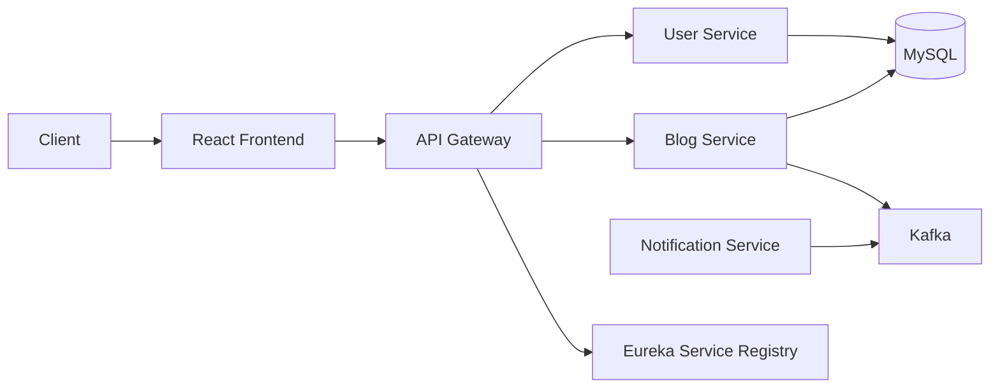

# Course-Blogging-Platform

A Spring Boot microservices-based blogging platform built with Java, React.js, MySQL, Kafka, and Docker. The project demonstrates a modular backend architecture, secure authentication, blog content management, event-driven notifications, and containerized deployment.

## Overview

This project is designed to provide a scalable content platform where users can create, manage, and search blog posts. It uses a microservice-based backend with a central API gateway, a service registry, and separate services for blog management, user management, and notifications.

It is a good example of:
- Java backend development
- Spring Boot microservices
- REST API design
- JWT authentication
- OAuth2 integration
- Kafka event-driven communication
- Docker Compose orchestration

## Key Features

- User registration and authentication
- JWT-based secure access
- Google OAuth2 login support
- Blog creation, update, and deletion
- Category and tag management
- Search/filter support
- API gateway for centralized routing
- Service discovery using Eureka
- Kafka-based notification flow
- Docker Compose setup for running the stack
- React frontend for user interaction

## Tech Stack

- Java
- Spring Boot
- Spring Security
- Spring Data JPA
- MySQL
- React.js
- Kafka
- Eureka
- API Gateway
- Docker
- Docker Compose
- Nginx

## Architecture

The repository includes multiple services working together:

- api-gateway
- blog-service
- user-service
- notification-service
- service-registery
- nginx



## Repository Structure

```text
Course-Blogging-Platform/
├── api-gateway/
├── blog-service/
├── user-service/
├── notification-service/
├── service-registery/
├── nginx/
├── Docker-compose.yml
├── README.md
├── .gitignore
├── app-check.jar
├── git
├── main
└── .idea/
```

## Prerequisites

Before running the project, make sure you have:

- Java 17+
- Maven
- MySQL
- Docker
- Docker Compose
- Node.js and npm (if you want to run or modify the frontend separately)

## Installation

Clone the repository:

```bash
git clone https://github.com/arun-sw/Course-Blogging-Platform.git
cd Course-Blogging-Platform
```

## Run with Docker Compose

The project includes Docker Compose for running the application stack.

```bash
docker compose up --build
```

To stop the stack:

```bash
docker compose down
```

## Local Setup

Each service can be started individually using Maven from its service folder.

Example:

```bash
cd blog-service
./mvnw spring-boot:run
```

You may need to run the services in separate terminals depending on your local setup.

## Configuration

Set environment variables for the services before running them. Use placeholders in local files or `.env` files; never commit real secrets.

Example:

```env
DB_PASSWORD=YOUR_DATABASE_PASSWORD
JWT_SECRET=YOUR_JWT_SECRET
GOOGLE_CLIENT_ID=YOUR_GOOGLE_CLIENT_ID
GOOGLE_CLIENT_SECRET=YOUR_GOOGLE_CLIENT_SECRET
KAFKA_BOOTSTRAP_SERVERS=localhost:9092
```

If you need a template file, you can create a `.env.example` file with placeholder values in the project root.

## Database Setup

This project uses MySQL for data persistence.

Recommended steps:
1. Start MySQL locally or through Docker Compose.
2. Create the required database(s) used by each service.
3. Update the service configuration with the correct database name, username, and password.
4. Ensure the service credentials match the database config in the project files.

Example database variables:
```env
MYSQL_DATABASE=blog_db
MYSQL_USER=YOUR_DB_USER
MYSQL_PASSWORD=YOUR_DB_PASSWORD
```

## API Overview

This project exposes REST APIs through the API gateway and service-specific endpoints. The exact route list should be checked against the controller classes in your local code before using them in production.

The project already documents examples such as:

- POST /categories
- POST /tags
- POST /blogs
- PUT /blogs/{id}
- DELETE /blogs/{id}?userId=1

### Example Blog Request

```json
{
  "userId": 1,
  "categoryId": 1,
  "title": "My first post",
  "content": "Hello blog"
}
```

## Authentication

The project includes:
- JWT-based authentication for protected routes
- Google OAuth2 login integration

Use placeholders for tokens, client IDs, and secrets in configuration and examples.

## Docker

The stack can be started using Docker Compose:

```bash
docker compose up --build
```

To rebuild after changes:

```bash
docker compose up --build --force-recreate
```

To remove containers and networks:

```bash
docker compose down
```

## Testing

Run project tests at the service level:

```bash
./mvnw test
```

For a full application stack, run tests in each relevant service.

## Troubleshooting

Common issues:
- MySQL is not running
- Required environment variables are not set
- Kafka is not available
- Service ports are already in use
- Docker containers are not built successfully
- Service config does not match the database credentials

Helpful checks:
```bash
docker ps
docker logs <container_name>
```

Also verify that each service is configured for the correct port and database connection.

## Future Improvements

These are suggested areas for improvement, not currently verified as implemented features:

- Add more detailed documentation for each microservice
- Improve service-level README files
- Add health check endpoints
- Increase test coverage
- Add CI/CD workflow setup
- Add production deployment guidance

## License

No verified license file was found in the repository root. If this project is intended for public reuse, add a proper LICENSE file before publishing the project as open source.

## Notes

This README is based on the project structure and available project documentation. For exact production API routes, service ports, and env configuration, verify the code in each service before relying on it for deployment or integration work.
